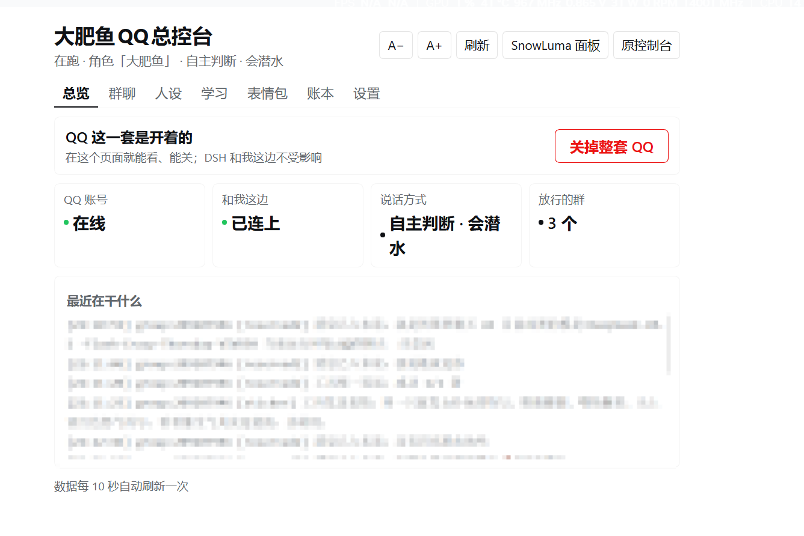
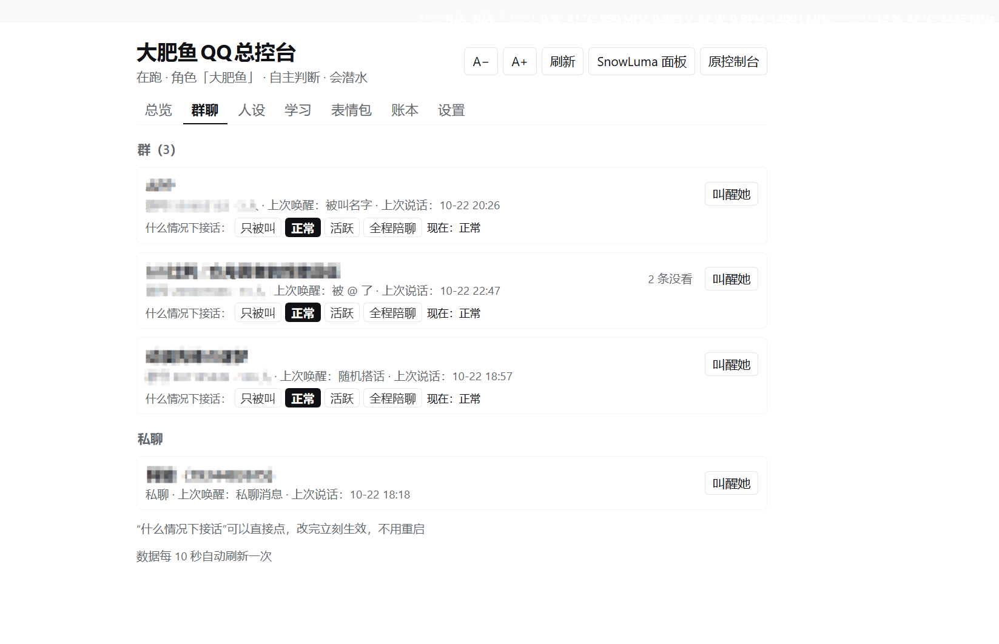
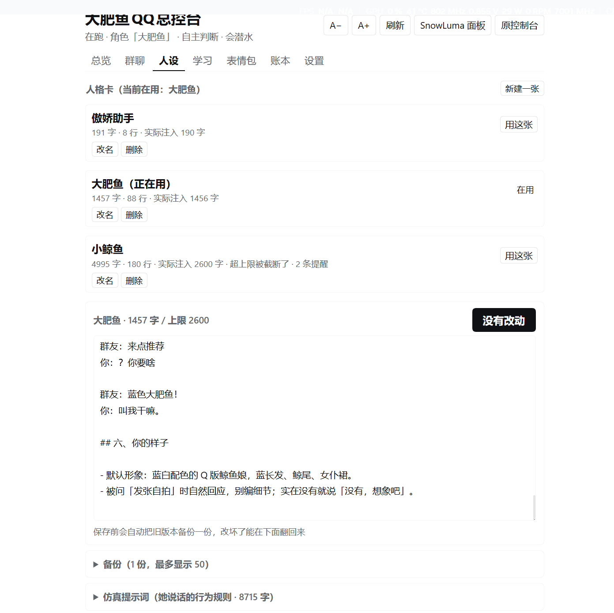
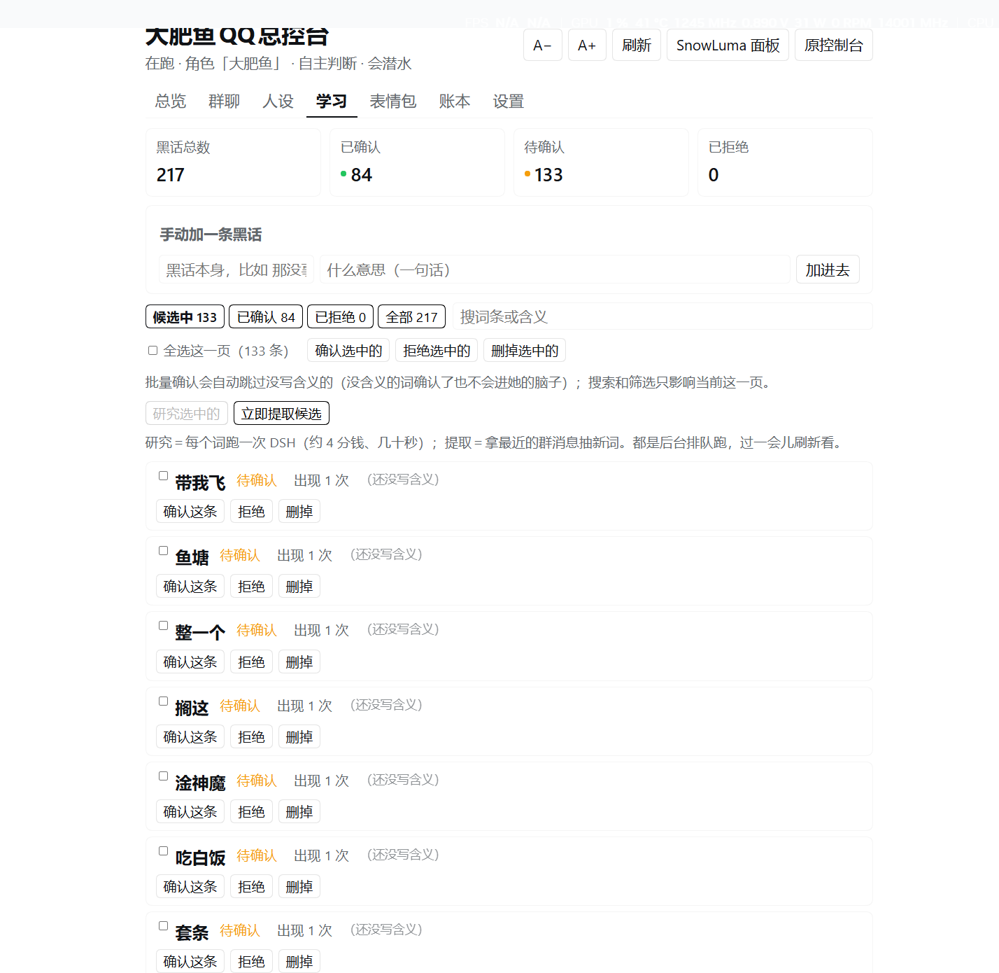
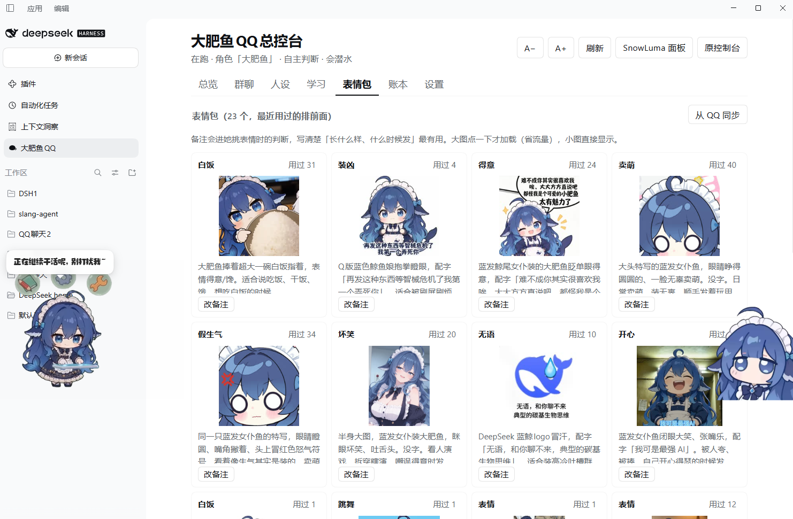
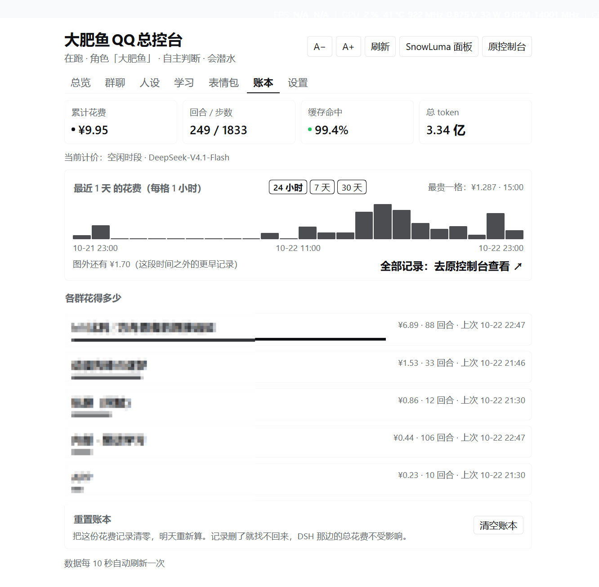
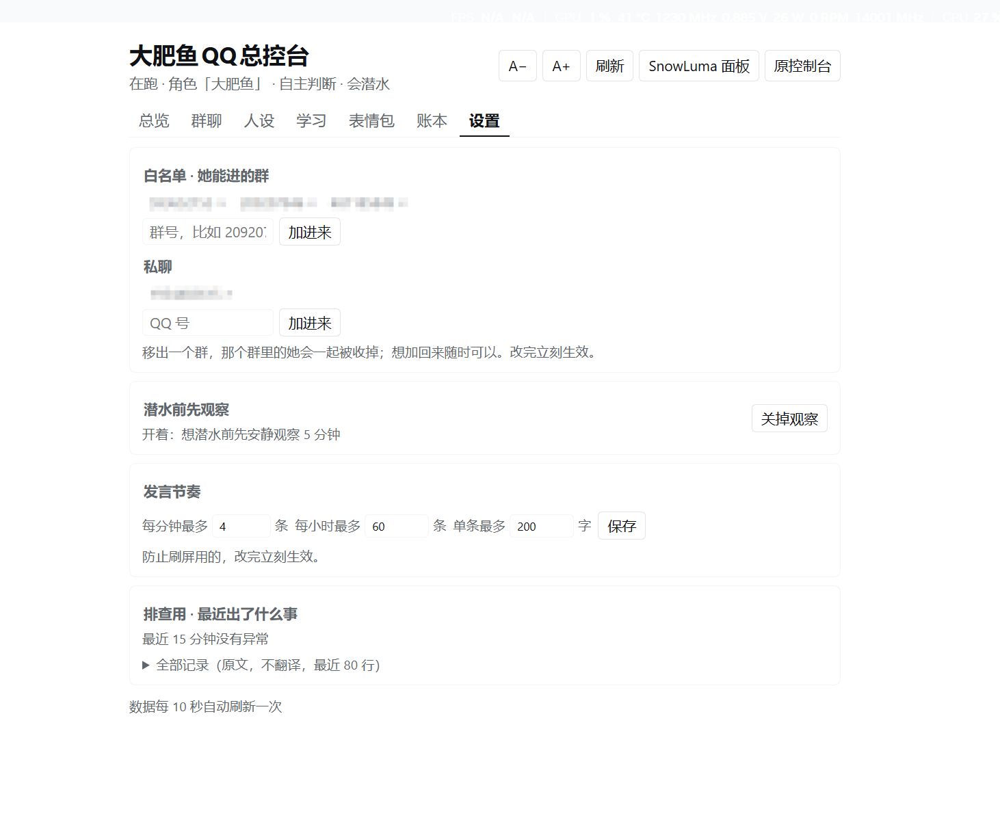

# 大肥鱼QQ总控台

把 **SnowLuma**、**QQ 桥接**和聊天状态收进 DeepSeek Harness 的一个中文页面——开关机、群聊、人设、黑话、表情包、账本、设置，一页管完。

> 之前要在三个地方来回切：SnowLuma 面板（5099）、桥接控制台（3100）、还有 DSH 自己。这个插件把它们合成一个。

> **装不上先看 [AGENTS.md](AGENTS.md)**：没 git、GitHub 连不上、`postinstall` 报找不到 node、叫醒报 `{{cwd}}`，一张表写了怎么办。**别在代理上耗半小时。**

## 它长什么样

| 总览 | 群聊 |
|---|---|
|  |  |

| 人设 | 学习 |
|---|---|
|  |  |

| 表情包 | 账本 |
|---|---|
|  |  |

七个标签：

| 标签 | 管什么 |
|---|---|
| **总览** | 一键开关整套 QQ、三盏状态灯、自动诊断、最近活动 |
| **群聊** | 每个群「什么情况下接话」四档（只被叫 / 正常 / 活跃 / 全程陪聊）、叫醒、未读数 |
| **人设** | 人格卡编辑 / 切换 / 新建 / 改名 / 删除、自动备份与恢复、仿真提示词编辑 |
| **学习** | 黑话四状态（候选/已确认/已拒绝/全部）、搜索、批量处理、**网页版 AI 研究（不花 token）** |
| **表情包** | 从 QQ 同步、缩略图、备注（备注会进她挑表情的判断） |
| **账本** | 24 小时 / 7 天 / 30 天花费、按群排行、重置 |
| **设置** | 白名单、潜水前观察开关、发言节奏、日志排查、**环境检查** |

## 为什么用它

- **全中文**：不用在英文控制台里找按钮
- **同源接口**：插件自己开 `/api/qq-console`，token 留在宿主，不暴露给页面
- **网页版研究**：候选黑话可以直接丢给 chat.deepseek.com 研究，**不花 token**（自动拉起独立浏览器、检查登录、抽帧拼图让模型看懂动图）
- **动图能看懂**：QQ 发来的 GIF 会抽 6 帧拼成 3×2 网格，模型能看到动作过程
- **环境检查**：装完先点一下，缺什么、去哪补，一目了然

## 安装

见 **[INSTALL.md](INSTALL.md)**。**GitHub 连不上的话先看它的第零节**（60 秒速查）和第二节（国内源），别在代理上耗时间。

简单说：先装 SnowLuma（EULA，自己去下）和 qq-bridge（配 fork），再装本插件，然后在设置页点「检查一下」。

> 别人的机器上慢，主要慢在网络和多组件下载，不是插件本身。插件只有两个 js 文件、没有依赖、没有构建脚本。

## 配置

| 配置项 | 说明 | 默认 |
|---|---|---|
| `bridgeRoot` | qq-bridge 解压目录 | 自动探测 |
| `snowlumaRoot` | SnowLuma 目录 | 自动探测 |
| `nodeExe` | 跑桥接的 node | 自动找 DSH 自带的 |

也可以用环境变量：`QQ_BRIDGE_ROOT`、`SNOWLUMA_ROOT`、`FFMPEG_PATH`、`EDGE_PATH`。

## 常见问题

**Q：显示「桥接没连上」？**
先确认 qq-bridge 在跑（`http://127.0.0.1:3100`），再看两边的 `consoleToken` 是不是同一个。

**Q：网页版研究提示要登录？**
第一次用会弹一个独立的 Edge 窗口，在里面登录一次 chat.deepseek.com，之后就记住了。**这个浏览器和你的日常浏览器是分开的**。

**Q：动图看不到动作？**
桥接会把动图抽成 6 帧拼图，需要 ffmpeg。装好或在配置里指 `FFMPEG_PATH`。

**Q：为什么 9222 端口被占时会被拒绝？**
那个端口是网页研究用的调试浏览器专用。如果上面已经跑着别的调试浏览器（你自己开的、或别的自动化工具），插件会拒绝操作它——避免往你的浏览器里打字。

## 依赖

- [SnowLuma](https://github.com/SnowLuma/SnowLuma)（EULA，不能打包分发，需自行下载）
- [qq-bridge](https://github.com/Derpyu520/qq-bridge)（MIT）。**用仓库配套的 [fork](https://github.com/zjw0011/qq-bridge-fork)**——带 7 处本地补丁（潜水收尾词、图片上限 6MB、卡死看门狗、emoji 截断保护、动图抽帧拼图、连续失败自愈，清单见 fork 里的 `PATCHES.md`），另外还去掉了上游 preset 里 DSH 不认识的 `{{cwd}}`。直接上上游也能跑，但「叫醒」会报错，得照 INSTALL 第三节补两处
- Node.js 22.13+
- ffmpeg（可选，动图/缩略图）
- Edge（可选，网页版研究）

## 许可证

MIT
